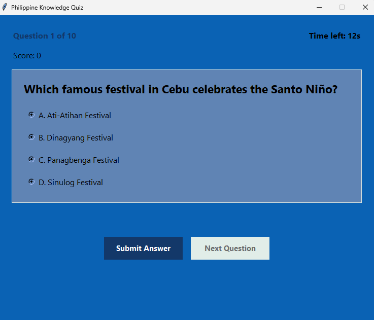
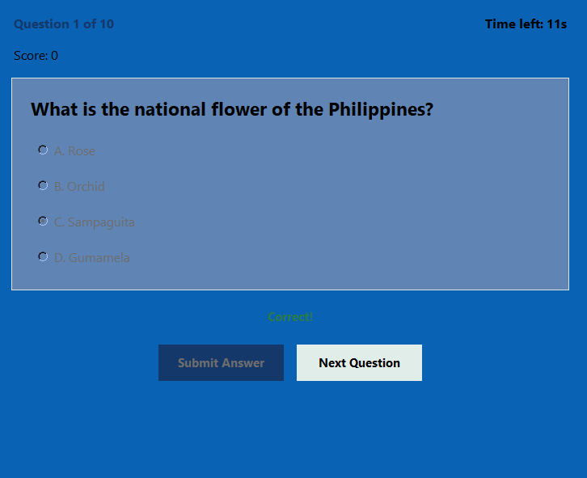
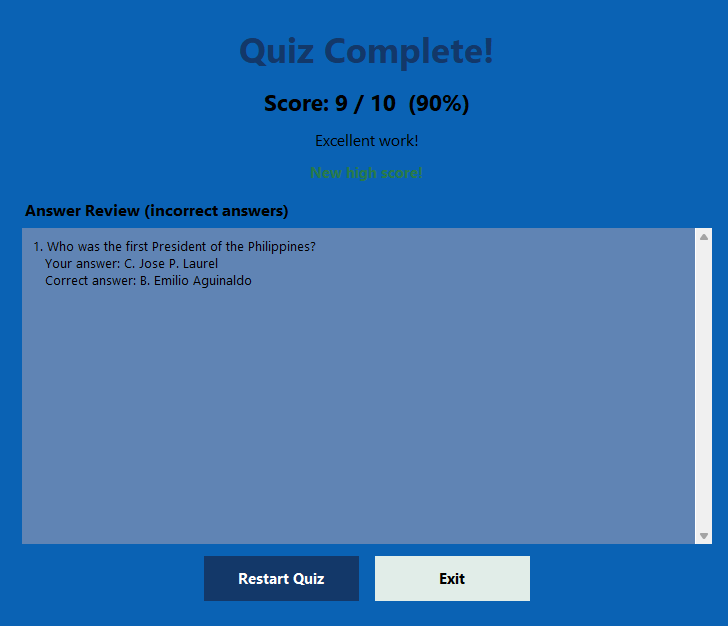

# Philippine Knowledge Quiz

**Name:** Edito T. Capispisan Jr.  
**Section:** BSINFOTECH SE 3-A  
**Topic:** Philippine General Knowledge

## Features
- 10 multiple-choice questions
- Randomized questions
- 15-second timer per question
- Automatic answer checking
- Score and percentage calculation
- Review of incorrect answers
- High score saved in a text file
- Restart and exit buttons

## How to Run
1. Install Python.
2. Open the project folder in VS Code.
3. Open the terminal.
4. Run `python random_quiz.py`.
   
## How the Questions Are Stored and Shuffled
I stored the questions in a list of dictionaries and each question has four choices and one correct answer. I used `random.sample()` to shuffle the questions everytime the quiz starts.

## How the Timer Works
Each question starts with 15 seconds. I used `root.after()` to update the timer every second. When an answer is submitted, the timer stops using `root.after_cancel()`. If time runs out, the question is marked wrong.

## How the Program Identifies the Correct Answer
The program gets the letter selected by the player and compares it with the correct answer stored in the question. If they match, the score increases by one.

## How the Score and High Score Work
The percentage is calculated using the score divided by the total number of questions, multiplied by 100. The program saves the highest score in `high_score.txt` and reads it again when opened.

## Function Explanations

| Function        | Purpose |                                Called When |
|---|---|---|
| `start_quiz()` | Resets the score and shuffles questions. | Start or Restart is clicked |
| `update_timer()` | Updates the countdown.                 | A question appears |
| `submit_answer()` | Checks the selected answer.           | Submit is clicked |
| `save_high_score()` | Saves a new highest score.          | Results are displayed |
| `show_results()` | Displays the final score and answer review. | All questions are finished |
| `time_up()` | Marks the question wrong when time runs out. | Timer reaches zero |

## Screenshots

## Challenges I Faced

One of my challenges was choosing the colors and layout for the application. I looked at some examples online and tried different color combinations until I found one that I liked.
